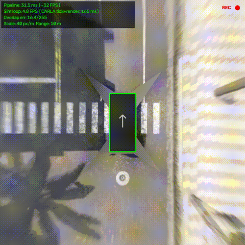
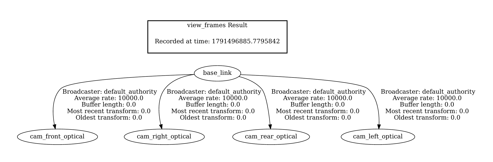

# CARLA 360 Surround View

CARLA simülatöründe araca 4 tane kamera koyup, bunlardan kuşbakışı (360 derece) bir görüntü oluşturan proje. İstersen sonucu ROS 2 topic'i olarak da yayınlıyor.

| 360 derece kuşbakışı görünüm | ROS 2 TF ağacı |
| :---: | :---: |
|  |  |

## Ne yapıyor?

- Araca ön, arka, sağ ve sol olmak üzere 4 kamera takıyor (her biri 640x480, 120 derece FOV).
- Kameraların görüntüsünü zemin düzlemine (z = 0) izdüşürüp tek bir kuşbakışı görüntüde birleştiriyor.
- İsterse bu görüntüyü ve kameraların TF bilgisini ROS 2'ye yayınlıyor.

## Nasıl çalışıyor?

Birleştirme için elle piksel noktası seçmedim. Kameranın FOV değerinden iç parametreleri, araca bağlı `carla.Transform` değerinden de konum ve yönünü hesaplıyorum. Böylece çıktıdaki her piksel, aracın çevresindeki zeminde gerçek bir (X, Y) metre noktasına denk geliyor.

- Dönüşüm haritalarını döngüye girmeden önce bir kere hesaplıyorum, sonra her karede sadece `cv2.remap` ile uyguluyorum.
- Kameraların birleştiği yerlerde görünen dikişi azaltmak için komşu kameraları açıya göre harmanlıyorum (alpha blending).
- Hiçbir kameranın göremediği yerler (aracın altı gibi) komşu piksellerden dolduruluyor.
- Birleşim yerlerinde iki kameranın renk farkını ölçüp ekrana yazıyorum. Düşükse hizalama iyi demek.

## Performans

| | Değer |
|---|---|
| Görüntü işleme süresi (remap + harmanlama) | yaklaşık 28 - 32 ms (31 - 36 FPS) |
| Tüm döngü (CARLA + işleme + ekran) | yaklaşık 5.4 FPS |
| Kapsama alanı | 20 m x 20 m (araçtan her yöne 10 m) |
| Çözünürlük | 40 piksel / metre, çıktı 800 x 800 |
| Kameralar arası renk farkı | 7.4 - 12.7 (0-255 arası) |

Görüntü işleme kısmı hızlı ama tüm döngü yavaş, çünkü zamanın çoğunu CARLA'nın 4 kamerayı render etmesi alıyor. Yani şu an gerçek zamanlı çalışmıyor, simülasyon gerçek zamandan yavaş akıyor.

Ölçümleri şu bilgisayarda yaptım: `<CPU / GPU yaz>`

## Kurulum

Ubuntu üzerinde geliştirdim. Gerekenler:

- CARLA 0.9.16
- Python 3 (CARLA'nın Python paketiyle uyumlu sürüm)
- ROS 2 Jazzy (sadece ROS 2 kısmını kullanacaksan)

1. Projeyi indir:

```bash
git clone https://github.com/cihat-aslan/carla-360-surround-view.git
cd carla-360-surround-view
```

2. Python paketlerini kur:

```bash
pip install numpy opencv-python
pip install carla==0.9.16
```

`carla` paketi pip'ten kurulmazsa CARLA klasöründeki `PythonAPI/carla/dist/` içinde bulunan `.whl` dosyasını `pip install` ile kurabilirsin.

## Çalıştırma

İki terminal lazım.

**Terminal 1: CARLA'yı başlat**

```bash
cd <CARLA'nın bulunduğu klasör>
./CarlaUE4.sh -RenderOffScreen -nosound
```

CARLA açılana kadar biraz bekle.

**Terminal 2: Programı çalıştır**

```bash
cd carla-360-surround-view
python3 surround_view.py
```

Bir pencere açılıp kuşbakışı görüntüyü gösterecek.

### ROS 2 ile çalıştırmak

Önce ROS 2'yi tanıt, sonra programı `--ros` ile aç:

```bash
source /opt/ros/jazzy/setup.bash
python3 surround_view.py --ros
```

Ham kamera görüntülerini de yayınlamak istersen:

```bash
python3 surround_view.py --ros --ros-cams
```

`ros_bridge.py` dosyasını ayrıca çalıştırmana gerek yok, `--ros` yazınca program onu kendisi çağırıyor.

Üçüncü bir terminalde yayınları kontrol edebilirsin:

```bash
source /opt/ros/jazzy/setup.bash
ros2 topic list
rviz2
```

RViz2'de Fixed Frame olarak `base_link` seç, sonra Image ve TF ekleyip `/surround_view/image_raw` topic'ini seç.

## Yayınlanan topic'ler

| Topic | Ne |
|---|---|
| `/surround_view/image_raw` | Kuşbakışı görüntü |
| `/surround_view/pipeline_ms` | İşleme süresi (ms) |
| `/surround_view/overlap_error` | Kameralar arası renk farkı |
| `/cameras/<ad>/image_raw` | Ham kamera görüntüsü (`--ros-cams` ile) |
| `/cameras/<ad>/camera_info` | Kamera bilgisi (`--ros-cams` ile) |
| `/tf_static` | `base_link` ile her kameranın konumu (`cam_<ad>_optical`) |

Kamera adları: `front`, `right`, `rear`, `left`.

## Tuşlar

- `q`: çıkış
- `r`: 10 saniyelik video kaydı (`surround_demo.mp4`)
- `g`: metre ızgarasını aç/kapat

## Ayarlar

`surround_view.py` dosyasının en üstündeki sabitlerden değiştirebilirsin:

- `RANGE_M`: araçtan her yöne kaç metre görüneceği
- `PX_PER_M`: 1 metrenin kaç piksel olacağı
- `CAMERAS`: kameraların araç üzerindeki konumu ve yönü
- `DT`: simülasyon adımı

Kamera konumlarını değiştirirsen dönüşüm kendiliğinden yeniden hesaplanıyor.

## Bilinen eksikler

- Sadece zemini doğru gösteriyor. Araba, kaldırım, direk gibi yerden yüksek şeyler kuşbakışında uzamış ve bozuk görünüyor, çünkü her şeyi zemindeymiş gibi varsayıyorum.
- Aracın altı kamera tarafından görülmediği için doldurma ile tamamlanıyor, araç da sabit bir dikdörtgen olarak çiziliyor.
- Lens bozulması simüle edilmediği için hesaba katmadım.

## Sık karşılaşılan hatalar

- `time-out` hatası: CARLA açık değil ya da henüz tam açılmadı.
- `No module named carla`: carla paketi kurulmamış ya da Python sürümü uyuşmuyor.
- `No module named rclpy`: `source /opt/ros/jazzy/setup.bash` komutunu çalıştırmayı unutmuşsundur.